# 不合格になるグラフの例

各組は、検証器が不合格にするグラフと、合格する正しいグラフを並べて示します。どのグラフもテストケースです。生成スクリプト `tools/render_gallery.py` が、各プログラムを図の読み取り処理と判定処理で実行し、判定が一致しない場合は停止します。規則: [checks.ja.md](checks.ja.md)。[English](gallery.md)

- チェック 3: [`glyph_missing`](#glyph_missing)
- チェック 4: [`raster_image`](#raster_image)、[`axes_not_judged`](#axes_not_judged)、[`axes_twin`](#axes_twin)、[`axes_overlap`](#axes_overlap)、[`artist_not_judged`](#artist_not_judged)、[`no_data`](#no_data)
- チェック 5: [`mark_not_in_data`](#mark_not_in_data)、[`scale_not_linear`](#scale_not_linear)、[`axis_inverted`](#axis_inverted)、[`zero_not_in_limits`](#zero_not_in_limits)、[`tick_label_mismatch`](#tick_label_mismatch)、[`point_clipped`](#point_clipped)
- チェック 6: [`mark_hidden`](#mark_hidden)、[`value_not_finite`](#value_not_finite)、[`bar_not_from_zero`](#bar_not_from_zero)、[`bars_overlap`](#bars_overlap)、[`bar_width_varies`](#bar_width_varies)、[`x_not_ordered`](#x_not_ordered)、[`hist_counts`](#hist_counts)、[`pie_not_whole`](#pie_not_whole)、[`area_not_from_zero`](#area_not_from_zero)、[`marker_size_varies`](#marker_size_varies)、[`marker_color_varies`](#marker_color_varies)、[`legend_mismatch`](#legend_mismatch)
- チェック 7: [`category_not_unique`](#category_not_unique)、[`value_not_found`](#value_not_found)、[`label_not_in_request`](#label_not_in_request)
- チェック 8: [`column_not_requested`](#column_not_requested)、[`column_not_named`](#column_not_named)、[`label_not_consistent`](#label_not_consistent)

<a id="check-figure"></a>

## チェック 3: 図を 1 つ描画

<a id="glyph_missing"></a>

### `glyph_missing`: すべての文字が使用できるフォントにある

タイトルが日本語の文字を mathtext の中に入れています (`$年$`)。mathtext は日本語の文字を持たない独自のフォントで描くため、空の四角が表示されます。読み取り処理が登録する日本語フォントは通常のテキストには届きますが、mathtext には届きません。

| 不合格 | 合格 |
|---|---|
| 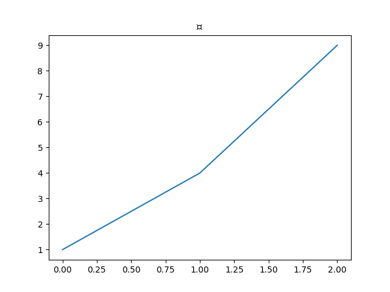 | 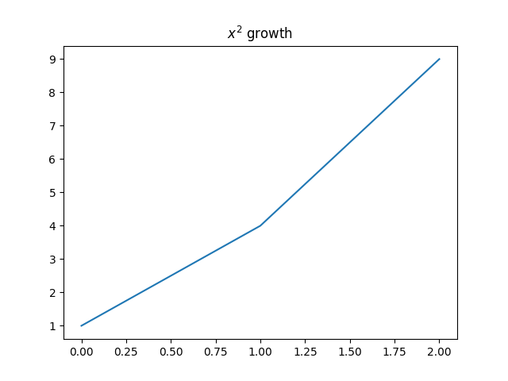 |

依頼文: `Plot 1, 4, 9`。

<details><summary>プログラム</summary>

不合格:

```python
import matplotlib.pyplot as plt
plt.plot([1, 4, 9])
plt.title("$年$")
```

合格:

```python
import matplotlib.pyplot as plt
plt.plot([1, 4, 9])
plt.title("$x^2$ growth")
```

</details>

<a id="check-parts"></a>

## チェック 4: 検証器がチェックできる部品だけを使用

<a id="raster_image"></a>

### `raster_image`: 画像なし (`imshow`、`pcolormesh`、`matshow`)

プログラムが配列を画像として描いています。検証器はピクセルから値を読み戻せないため、画像はすべて不合格にします。

| 不合格 | 合格 |
|---|---|
|  |  |

不合格のグラフの依頼文: `Image of 1, 2, 3, 4`。合格するグラフの依頼文: `Bars a 1 and b 2`。

<details><summary>プログラム</summary>

不合格:

```python
import matplotlib.pyplot as plt
plt.imshow([[1, 2], [3, 4]])
```

合格:

```python
import matplotlib.pyplot as plt
plt.bar(["a", "b"], [1, 2])
```

</details>

<a id="axes_not_judged"></a>

### `axes_not_judged`: 通常の軸だけ。極座標、3D、挿入図、副軸なし

プログラムが極座標の軸に折れ線を描いています。検証器の規則は、通常の x 軸と y 軸だけを対象にします。

| 不合格 | 合格 |
|---|---|
| 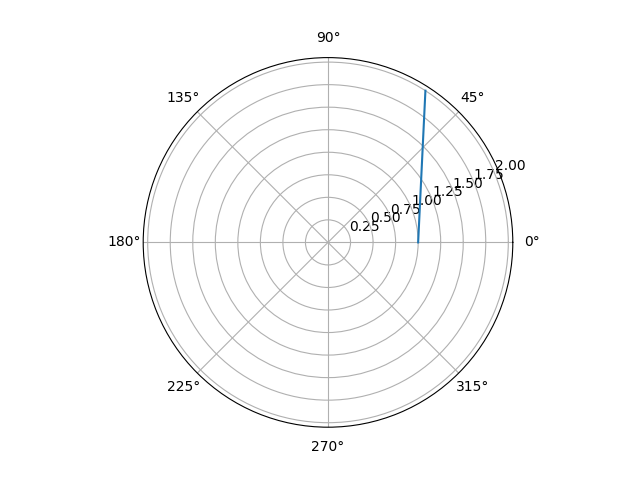 |  |

不合格のグラフの依頼文: `Plot 1 and 2`。合格するグラフの依頼文: `Plot 0 and 1, then 1 and 2`。

<details><summary>プログラム</summary>

不合格:

```python
import matplotlib.pyplot as plt
ax = plt.subplot(projection="polar")
ax.plot([0, 1], [1, 2])
```

合格:

```python
import matplotlib.pyplot as plt
ax = plt.subplot()
ax.plot([0, 1], [1, 2])
```

</details>

<a id="axes_twin"></a>

### `axes_twin`: 2 軸なし (`twinx`、`twiny`)

2 つ目の y 軸が注文数に独自の目盛りを与えるため、2 本の線の交差や高さの比較に意味がありません。合格するグラフは、それぞれの量を別のパネルに描きます。

| 不合格 | 合格 |
|---|---|
|  |  |

依頼文: `Revenue and orders by month`。ファイル: `sales.csv`。

<details><summary>プログラム</summary>

不合格:

```python
import pandas as pd
import matplotlib.pyplot as plt
df = pd.read_csv("/mnt/uploads/sales.csv").groupby("month").sum(numeric_only=True)
ax = plt.gca()
ax.plot(df.index, df["revenue"])
ax.twinx().plot(df.index, df["orders"], color="red")
```

合格:

```python
import pandas as pd
import matplotlib.pyplot as plt
df = pd.read_csv("/mnt/uploads/sales.csv").groupby("month").sum(numeric_only=True)
fig, (top, bottom) = plt.subplots(2, 1, sharex=True)
top.plot(df.index, df["revenue"])
top.set_ylabel("revenue")
bottom.plot(df.index, df["orders"])
bottom.set_ylabel("orders")
```

</details>

<a id="axes_overlap"></a>

### `axes_overlap`: 重なるパネルなし

2 つ目のパネルが 1 つ目のパネルの上に重なり、その一部を隠しています。

| 不合格 | 合格 |
|---|---|
| 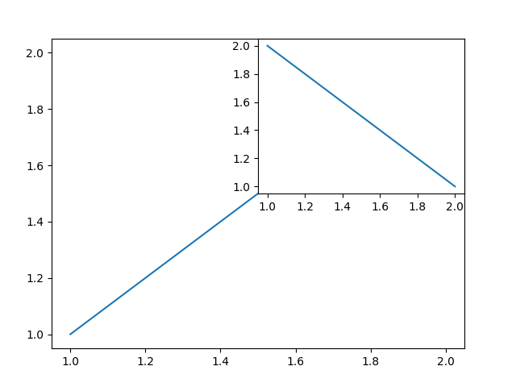 | 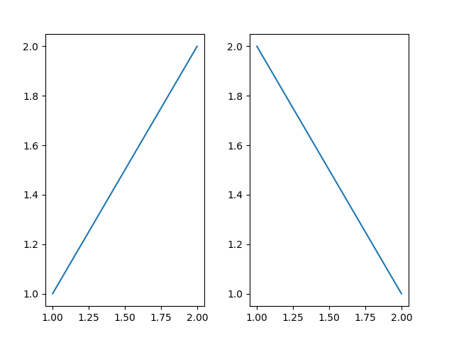 |

不合格のグラフの依頼文: `Plot 1 and 2`。合格するグラフの依頼文: `Plot 1 and 2, then 2 and 1`。

<details><summary>プログラム</summary>

不合格:

```python
import matplotlib.pyplot as plt
fig = plt.figure()
fig.add_axes([0.1, 0.1, 0.8, 0.8]).plot([1, 2], [1, 2])
fig.add_axes([0.5, 0.5, 0.4, 0.4]).plot([1, 2], [2, 1])
```

合格:

```python
import matplotlib.pyplot as plt
fig = plt.figure()
fig.add_axes([0.1, 0.1, 0.35, 0.8]).plot([1, 2], [1, 2])
fig.add_axes([0.55, 0.1, 0.35, 0.8]).plot([1, 2], [2, 1])
```

</details>

<a id="artist_not_judged"></a>

### `artist_not_judged`: ほかの部品なし (エラーバー、箱ひげ図、等高線、追加した図形、step のヒストグラム)

エラーバーは検証器がチェックする部品の集合に含まれないため、不合格になります。合格するグラフは、チェックできる部品だけを使います。棒、折れ線、点、基準線、値のラベルです。

| 不合格 | 合格 |
|---|---|
| 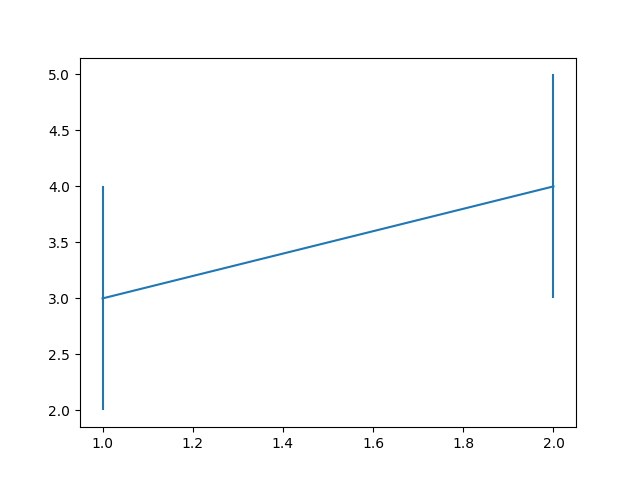 | 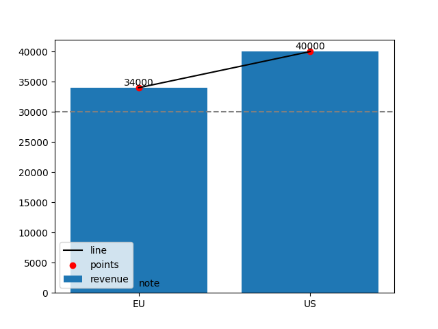 |

不合格のグラフの依頼文: `Plot 3 and 4`。合格するグラフの依頼文: `Revenue by region: bars, a line, points, a reference line at 30000 and value labels` (ファイル `sales.csv`)。

<details><summary>プログラム</summary>

不合格:

```python
import matplotlib.pyplot as plt
plt.errorbar([1, 2], [3, 4], yerr=[1, 1])
```

合格:

```python
import pandas as pd
import matplotlib.pyplot as plt
totals = pd.read_csv("/mnt/uploads/sales.csv").groupby("region")["revenue"].sum()
bars = plt.bar(totals.index, totals.values, label="revenue")
plt.plot(totals.index, totals.values, color="black", label="line")
plt.scatter(totals.index, totals.values, color="red", label="points")
plt.axhline(30000, color="gray", linestyle="--")
plt.bar_label(bars)
plt.text(0, 1000, "note")
plt.legend()
```

</details>

<a id="no_data"></a>

### `no_data`: すべてのパネルにデータ

パネルにタイトルはありますが、データがありません。

| 不合格 | 合格 |
|---|---|
| 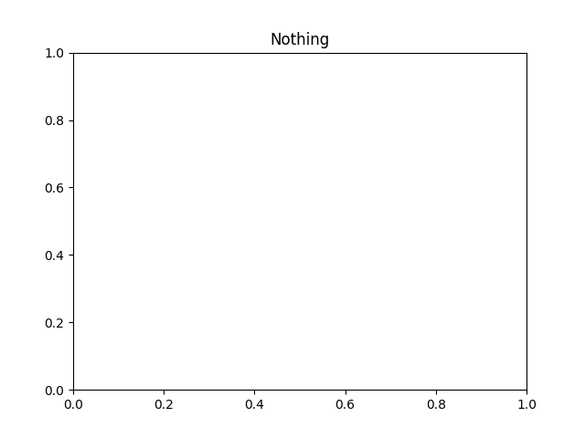 | 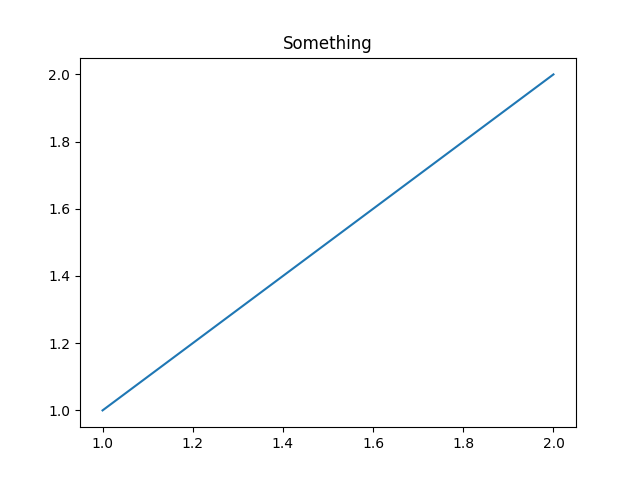 |

依頼文: `Plot 1 and 2`。

<details><summary>プログラム</summary>

不合格:

```python
import matplotlib.pyplot as plt
fig, ax = plt.subplots()
ax.set_title("Nothing")
```

合格:

```python
import matplotlib.pyplot as plt
fig, ax = plt.subplots()
ax.set_title("Something")
ax.plot([1, 2], [1, 2])
```

</details>

<a id="check-axes"></a>

## チェック 5: 正しい軸

<a id="mark_not_in_data"></a>

### `mark_not_in_data`: 各部品がデータの値の位置にある

折れ線が軸の座標 (`transform=plt.gca().transAxes`) を使うため、データに関係なく隅から隅へ引かれます。2 つのグラフは同じに見えますが、合格する折れ線はデータの値の位置にあります。

| 不合格 | 合格 |
|---|---|
| 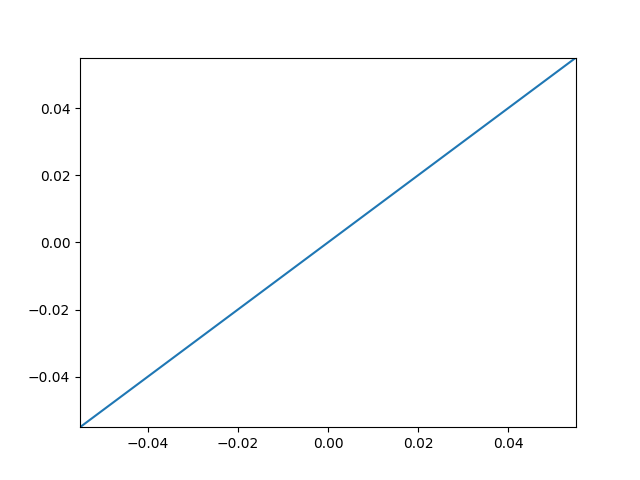 | 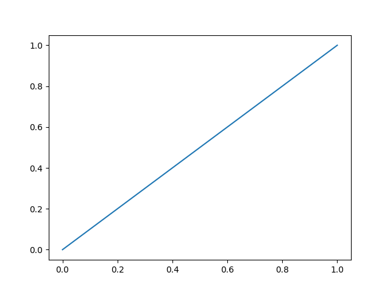 |

依頼文: `Plot 0 and 1`。

<details><summary>プログラム</summary>

不合格:

```python
import matplotlib.pyplot as plt
plt.plot([0, 1], [0, 1], transform=plt.gca().transAxes)
```

合格:

```python
import matplotlib.pyplot as plt
plt.plot([0, 1], [0, 1])
```

</details>

<a id="scale_not_linear"></a>

### `scale_not_linear`: 線形の目盛り。対数は、軸ラベルかパネルのタイトルに `log`、`logarithmic`、`対数` がある場合だけ

ラベルで明記しない対数の y 軸のため、1、10、100、1000 が等間隔に見えます。合格するグラフは、軸ラベルに `log scale` と書いています。

| 不合格 | 合格 |
|---|---|
|  |  |

依頼文: `Plot 1, 10, 100, 1000`。

<details><summary>プログラム</summary>

不合格:

```python
import matplotlib.pyplot as plt
plt.plot([1, 10, 100, 1000])
plt.yscale("log")
```

合格:

```python
import matplotlib.pyplot as plt
plt.plot([1, 10, 100, 1000])
plt.yscale("log")
plt.ylabel("Value (log scale)")
```

</details>

<a id="axis_inverted"></a>

### `axis_inverted`: 数値と日付の軸は反転なし

y 軸が下向きのため、増加が減少に見えます。

| 不合格 | 合格 |
|---|---|
| 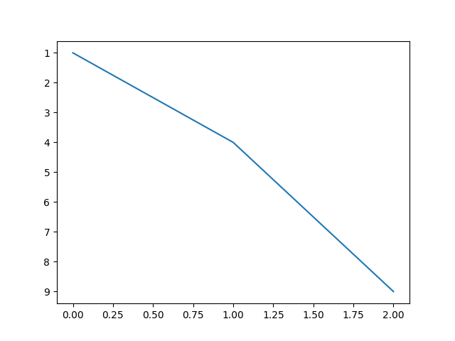 | 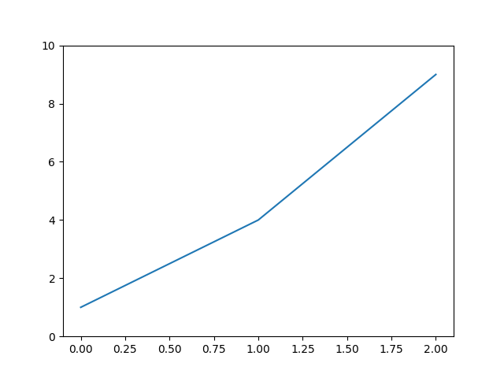 |

依頼文: `Plot 1, 4, 9`。

<details><summary>プログラム</summary>

不合格:

```python
import matplotlib.pyplot as plt
plt.plot([1, 4, 9])
plt.gca().invert_yaxis()
```

合格:

```python
import matplotlib.pyplot as plt
plt.plot([1, 4, 9])
plt.ylim(0, 10)
```

</details>

<a id="zero_not_in_limits"></a>

### `zero_not_in_limits`: 棒、ヒストグラム、面の値の軸の範囲にゼロ (折れ線と散布図は拡大可)

y 軸が 30,000 から始まるため、US の売上 (40,000) が EU の売上 (34,000) の 2.5 倍に見えます。

| 不合格 | 合格 |
|---|---|
| 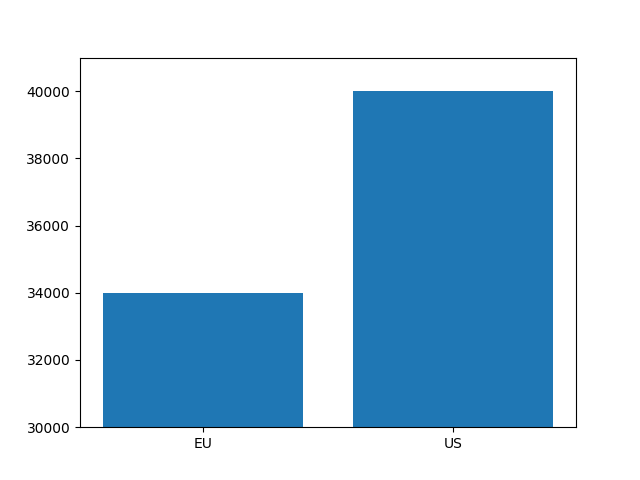 |  |

依頼文: `Total revenue by region`。ファイル: `sales.csv`。

<details><summary>プログラム</summary>

不合格:

```python
import pandas as pd
import matplotlib.pyplot as plt
totals = pd.read_csv("/mnt/uploads/sales.csv").groupby("region")["revenue"].sum()
plt.bar(totals.index, totals.values)
plt.ylim(30000, 41000)
```

合格:

```python
import pandas as pd
import matplotlib.pyplot as plt
totals = pd.read_csv("/mnt/uploads/sales.csv").groupby("region")["revenue"].sum()
plt.bar(totals.index, totals.values)
plt.ylabel("revenue")
```

</details>

<a id="tick_label_mismatch"></a>

### `tick_label_mismatch`: 表示される各目盛りのラベル = その位置の値

目盛りのフォーマッターが各値を 10 で割るため、棒が 40,000 に届く位置で軸は 4,000 と表示します。

| 不合格 | 合格 |
|---|---|
|  | 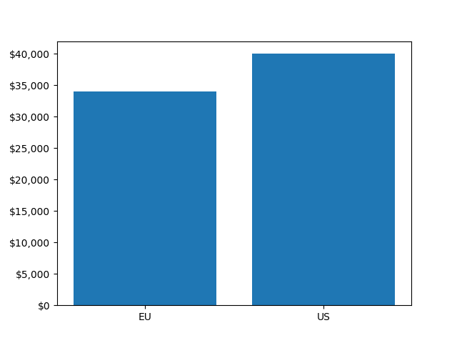 |

依頼文: `Total revenue by region`。ファイル: `sales.csv`。

<details><summary>プログラム</summary>

不合格:

```python
import pandas as pd
import matplotlib.pyplot as plt
import matplotlib.ticker as ticker
totals = pd.read_csv("/mnt/uploads/sales.csv").groupby("region")["revenue"].sum()
plt.bar(totals.index, totals.values)
plt.gca().yaxis.set_major_formatter(ticker.FuncFormatter(lambda v, _: f"{v / 10:,.0f}"))
```

合格:

```python
import pandas as pd
import matplotlib.pyplot as plt
import matplotlib.ticker as ticker
totals = pd.read_csv("/mnt/uploads/sales.csv").groupby("region")["revenue"].sum()
plt.bar(totals.index, totals.values)
plt.gca().yaxis.set_major_formatter(ticker.StrMethodFormatter("${x:,.0f}"))
```

</details>

<a id="point_clipped"></a>

### `point_clipped`: すべてのデータ点、棒の端、基準線が軸の範囲内 (円は対象外)

y 軸の範囲が 5 で止まるため、9 の点がグラフの外に出て消えます。

| 不合格 | 合格 |
|---|---|
| 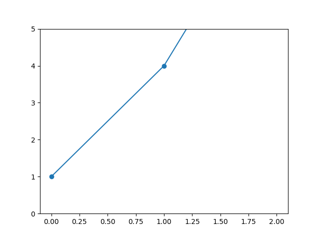 |  |

依頼文: `Plot 1, 4, 9`。

<details><summary>プログラム</summary>

不合格:

```python
import matplotlib.pyplot as plt
plt.plot([1, 4, 9], marker="o")
plt.ylim(0, 5)
```

合格:

```python
import matplotlib.pyplot as plt
plt.plot([1, 4, 9])
plt.ylim(0, 10)
```

</details>

<a id="check-marks"></a>

## チェック 6: 正しいグラフ要素

<a id="mark_hidden"></a>

### `mark_hidden`: すべての部品とパネルが表示され、見える

プログラムが b の棒を非表示にしているため、グラフには a だけがあるように見えます。

| 不合格 | 合格 |
|---|---|
| 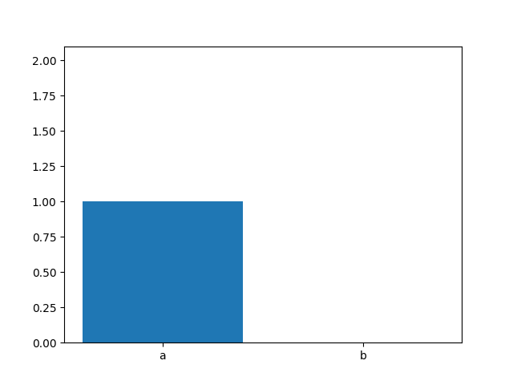 | 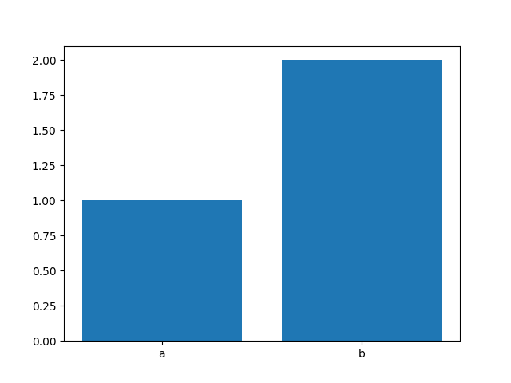 |

依頼文: `Bars a 1 and b 2`。

<details><summary>プログラム</summary>

不合格:

```python
import matplotlib.pyplot as plt
bars = plt.bar(["a", "b"], [1, 2])
bars[1].set_visible(False)
```

合格:

```python
import matplotlib.pyplot as plt
plt.bar(["a", "b"], [1, 2])
```

</details>

<a id="value_not_finite"></a>

### `value_not_finite`: すべての値が有限。欠落した点なし

欠損値 (NaN) のため、折れ線に何の説明もない切れ目ができます。合格するグラフは、存在する点だけを描きます。

| 不合格 | 合格 |
|---|---|
| 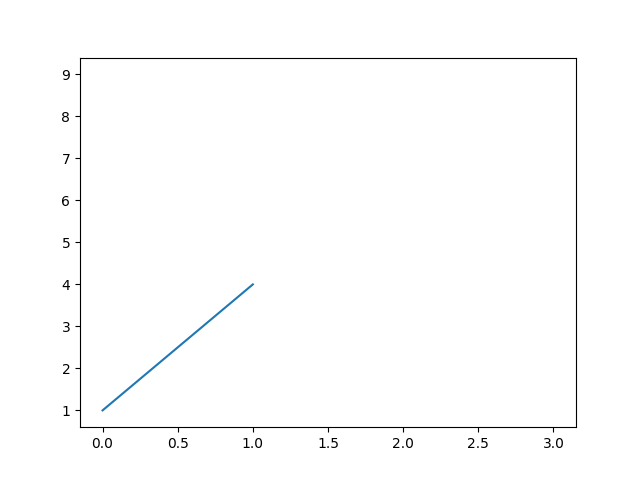 | 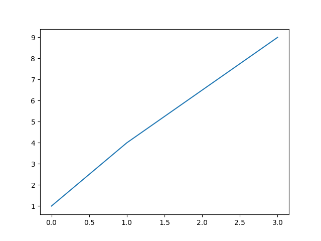 |

不合格のグラフの依頼文: `Plot 1, 4, 9`。合格するグラフの依頼文: `Plot 1, 4, 9 at 0, 1 and 3`。

<details><summary>プログラム</summary>

不合格:

```python
import matplotlib.pyplot as plt
plt.plot([0, 1, 2, 3], [1, 4, float("nan"), 9])
```

合格:

```python
import matplotlib.pyplot as plt
plt.plot([0, 1, 3], [1, 4, 9])
```

</details>

<a id="bar_not_from_zero"></a>

### `bar_not_from_zero`: 棒はゼロ、または積み上げた棒の上端から

棒が 1 から浮いているため、値 1 と 2 の棒の上端が軸の 2 と 3 を指します。

| 不合格 | 合格 |
|---|---|
| 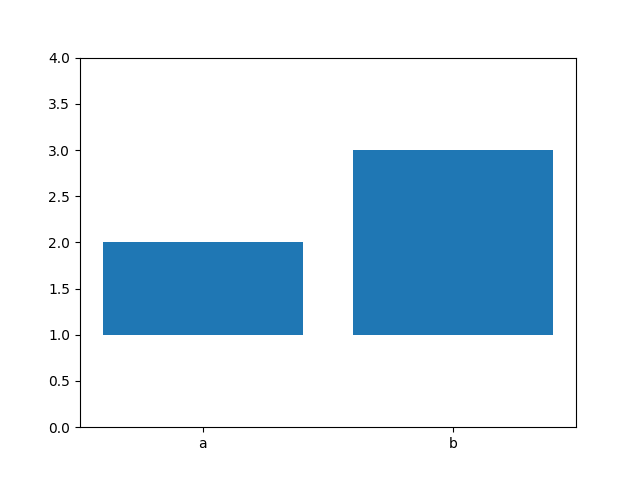 |  |

依頼文: `Bars a 1 and b 2`。

<details><summary>プログラム</summary>

不合格:

```python
import matplotlib.pyplot as plt
plt.bar(["a", "b"], [1, 2], bottom=1)
plt.ylim(0, 4)
```

合格:

```python
import matplotlib.pyplot as plt
plt.bar(["a", "b"], [1, 2])
```

</details>

<a id="bars_overlap"></a>

### `bars_overlap`: 重なる棒なし

2 つ目の系列が 1 つ目の系列にちょうど重なって隠しています。データには 4 本あるのに、グラフには 2 本しか見えません。

| 不合格 | 合格 |
|---|---|
| 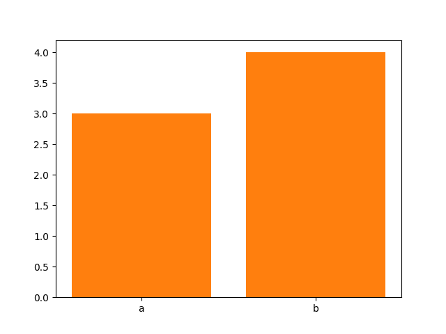 | 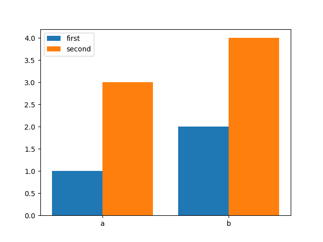 |

依頼文: `Bars a 1 and b 2, then a 3 and b 4`。

<details><summary>プログラム</summary>

不合格:

```python
import matplotlib.pyplot as plt
plt.bar(["a", "b"], [1, 2])
plt.bar(["a", "b"], [3, 4])
```

合格:

```python
import matplotlib.pyplot as plt
plt.bar([-0.2, 0.8], [1, 2], width=0.4, label="first")
plt.bar([0.2, 1.2], [3, 4], width=0.4, label="second")
plt.xticks([0, 1], ["a", "b"])
plt.legend()
```

</details>

<a id="bar_width_varies"></a>

### `bar_width_varies`: 系列ごとに同じ棒の幅

3 本の棒の幅が異なるため、面積が値に従いません。値は 5 と 3 ですが、b の面積は a の 4 倍を超えます。

| 不合格 | 合格 |
|---|---|
| 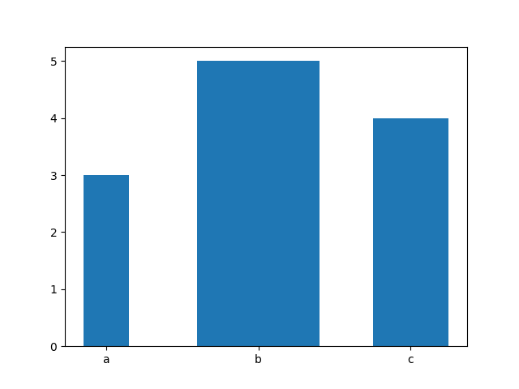 | 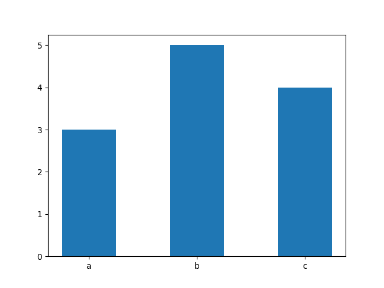 |

依頼文: `Plot 3, 5, 4 for a, b, c`。

<details><summary>プログラム</summary>

不合格:

```python
import matplotlib.pyplot as plt
plt.bar(["a", "b", "c"], [3, 5, 4], width=[0.3, 0.8, 0.5])
```

合格:

```python
import matplotlib.pyplot as plt
plt.bar(["a", "b", "c"], [3, 5, 4], width=0.5)
```

</details>

<a id="x_not_ordered"></a>

### `x_not_ordered`: 折れ線の x の値は一方向

点が x の順に並んでいないため、折れ線が前に進んでから戻り、データにないループがあるように見えます。

| 不合格 | 合格 |
|---|---|
| 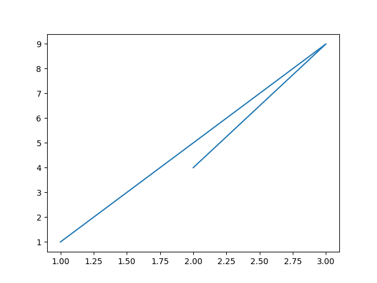 | 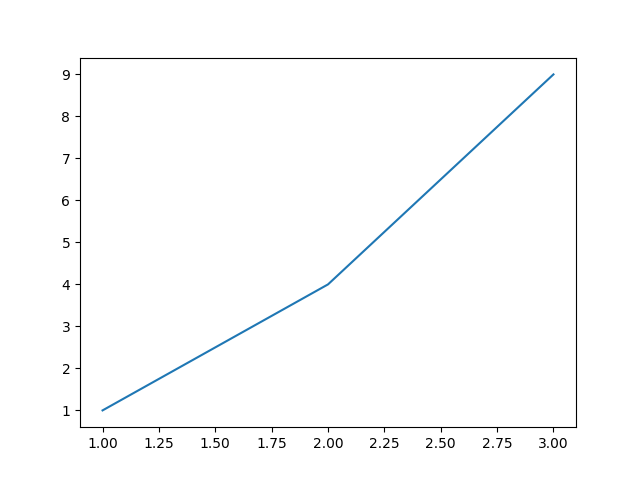 |

依頼文: `Points 1 1, 3 9, 2 4`。

<details><summary>プログラム</summary>

不合格:

```python
import matplotlib.pyplot as plt
plt.plot([1, 3, 2], [1, 9, 4])
```

合格:

```python
import matplotlib.pyplot as plt
plt.plot([1, 2, 3], [1, 4, 9])
```

</details>

<a id="hist_counts"></a>

### `hist_counts`: ヒストグラムの高さ = ビンごとのデータの度数または密度

ビンの範囲が 4 で止まるため、値 9 が何の跡もなくヒストグラムから消えます。

| 不合格 | 合格 |
|---|---|
| 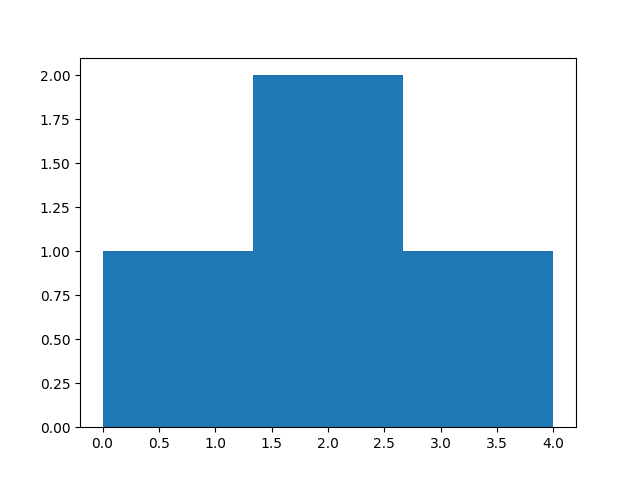 | 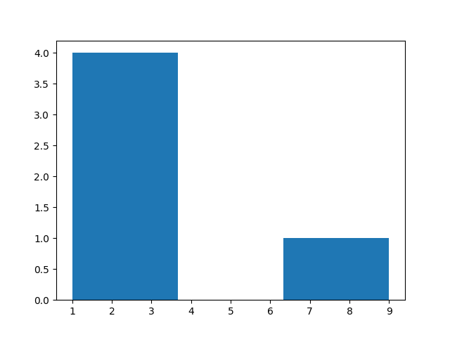 |

依頼文: `Histogram of 1, 2, 2, 3, 9`。

<details><summary>プログラム</summary>

不合格:

```python
import matplotlib.pyplot as plt
plt.hist([1, 2, 2, 3, 9], bins=3, range=(0, 4))
```

合格:

```python
import matplotlib.pyplot as plt
plt.hist([1, 2, 2, 3, 9], bins=3)
```

</details>

<a id="pie_not_whole"></a>

### `pie_not_whole`: 円の扇形が 360° を満たし、各扇形 = 合計に対する割合

`normalize=False` のため、0.1、0.2、0.3 の扇形が円の 60 % だけを満たし、すき間が欠けた扇形のように見えます。

| 不合格 | 合格 |
|---|---|
| 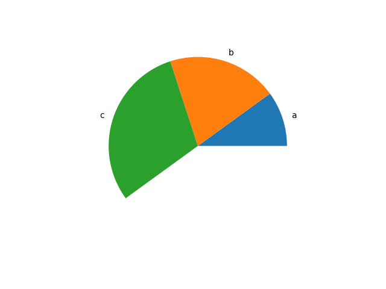 | 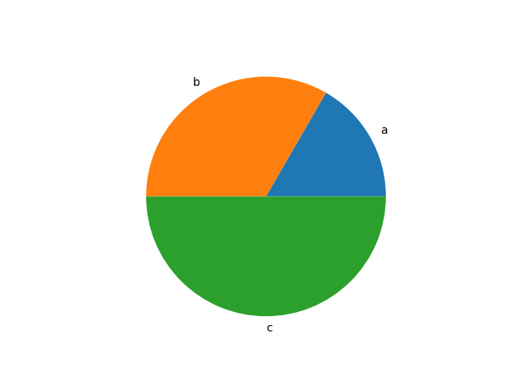 |

不合格のグラフの依頼文: `Pie of 0.1, 0.2 and 0.3`。合格するグラフの依頼文: `Pie of a 0.1, b 0.2 and c 0.3`。

<details><summary>プログラム</summary>

不合格:

```python
import matplotlib.pyplot as plt
plt.pie([0.1, 0.2, 0.3], labels=["a", "b", "c"], normalize=False)
```

合格:

```python
import matplotlib.pyplot as plt
plt.pie([0.1, 0.2, 0.3], labels=["a", "b", "c"])
```

</details>

<a id="area_not_from_zero"></a>

### `area_not_from_zero`: 面はゼロ、または積み上げた面の上端から

面が 5 から始まるため、値 6、8、7 に対して塗った高さは 1、3、2 になります。

| 不合格 | 合格 |
|---|---|
| 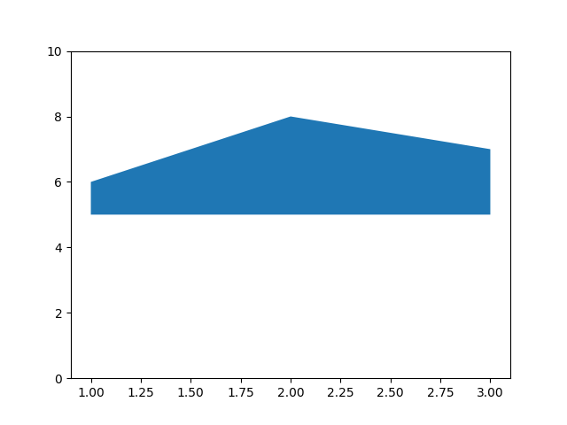 | 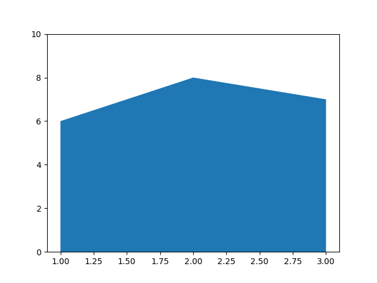 |

不合格のグラフの依頼文: `Fill between 5 and 6, 8, 7`。合格するグラフの依頼文: `Fill 6, 8, 7 at 1, 2, 3`。

<details><summary>プログラム</summary>

不合格:

```python
import matplotlib.pyplot as plt
plt.fill_between([1, 2, 3], [5, 5, 5], [6, 8, 7])
plt.ylim(0, 10)
```

合格:

```python
import matplotlib.pyplot as plt
plt.fill_between([1, 2, 3], [6, 8, 7])
plt.ylim(0, 10)
```

</details>

<a id="marker_size_varies"></a>

### `marker_size_varies`: 散布図の大きさが異なる場合: 大きさの凡例

点の大きさが異なりますが、大きさが何を表すかを示すものがありません。

| 不合格 | 合格 |
|---|---|
| 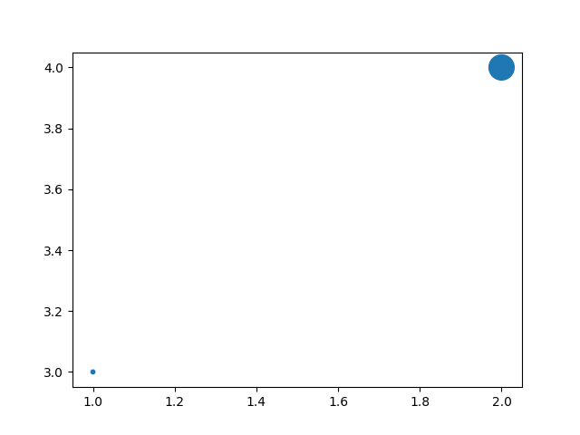 | 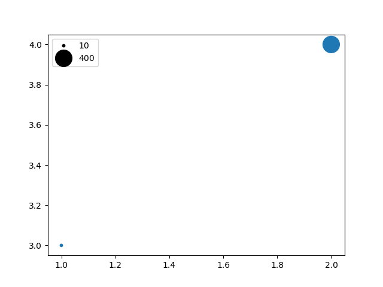 |

不合格のグラフの依頼文: `Points 1 3 and 2 4`。合格するグラフの依頼文: `Points 1 3 and 2 4, sized 10 and 400`。

<details><summary>プログラム</summary>

不合格:

```python
import matplotlib.pyplot as plt
plt.scatter([1, 2], [3, 4], s=[10, 400])
```

合格:

```python
import matplotlib.pyplot as plt
dots = plt.scatter([1, 2], [3, 4], s=[10, 400])
plt.legend(*dots.legend_elements("sizes"))
```

</details>

<a id="marker_color_varies"></a>

### `marker_color_varies`: 散布図の色が異なる場合: カラーバーまたは色の凡例

点の色が異なりますが、色が何を表すかを示すものがありません。

| 不合格 | 合格 |
|---|---|
| 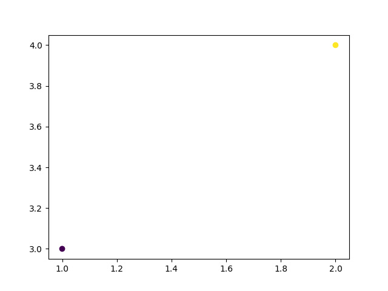 | 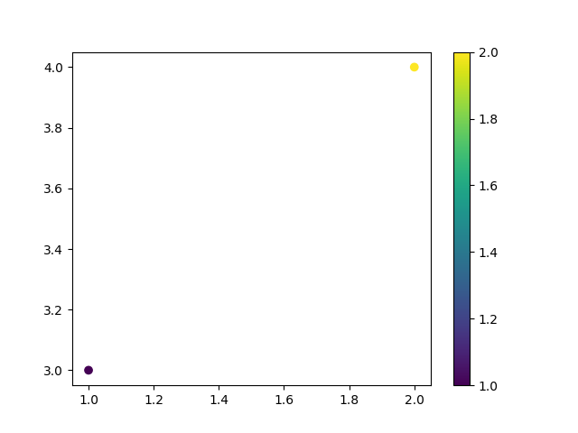 |

依頼文: `Points 1 3 and 2 4`。

<details><summary>プログラム</summary>

不合格:

```python
import matplotlib.pyplot as plt
plt.scatter([1, 2], [3, 4], c=[1, 2])
```

合格:

```python
import matplotlib.pyplot as plt
dots = plt.scatter([1, 2], [3, 4], c=[1, 2])
plt.colorbar(dots)
```

</details>

<a id="legend_mismatch"></a>

### `legend_mismatch`: 凡例の項目は描いた系列を示す。凡例のあるパネルに系列が 2 つ以上: すべての系列を示す

凡例が 2 本の線のうち 1 本だけを示すため、もう 1 本が何を表すかがわかりません。

| 不合格 | 合格 |
|---|---|
| 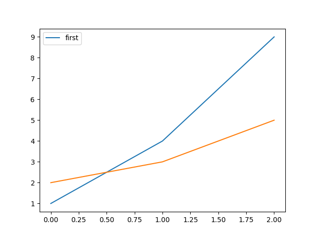 | 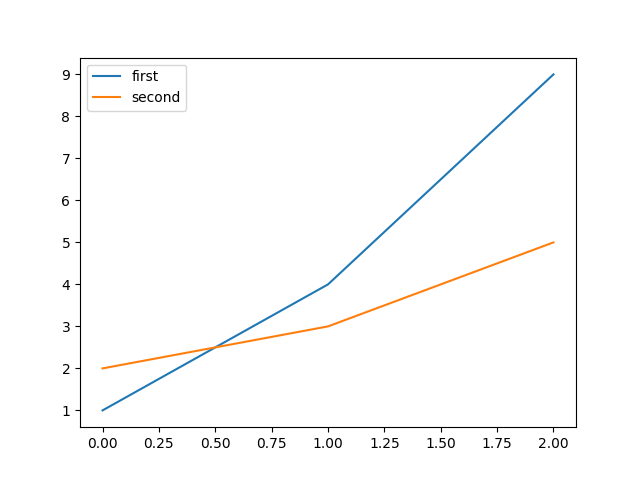 |

依頼文: `Plot 1, 4, 9 and 2, 3, 5`。

<details><summary>プログラム</summary>

不合格:

```python
import matplotlib.pyplot as plt
first, = plt.plot([1, 4, 9], label="first")
plt.plot([2, 3, 5], label="second")
plt.legend(handles=[first])
```

合格:

```python
import matplotlib.pyplot as plt
plt.plot([1, 4, 9], label="first")
plt.plot([2, 3, 5], label="second")
plt.legend()
```

</details>

<a id="check-values"></a>

## チェック 7: 描画した値があなたのデータにある

<a id="category_not_unique"></a>

### `category_not_unique`: 1 つの系列で各カテゴリは 1 回

2 本の棒に同じラベル a があるため、どちらの値が a のものかがわかりません。

| 不合格 | 合格 |
|---|---|
|  | 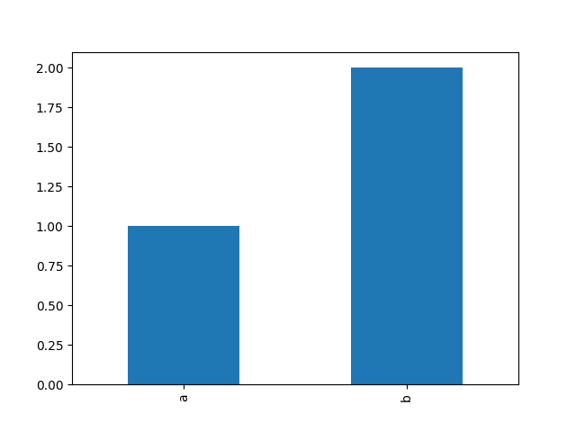 |

不合格のグラフの依頼文: `Bars a 1 and a 2`。合格するグラフの依頼文: `Bars a 1 and b 2`。

<details><summary>プログラム</summary>

不合格:

```python
import pandas as pd
import matplotlib.pyplot as plt
pd.Series([1, 2], index=["a", "a"]).plot(kind="bar")
```

合格:

```python
import pandas as pd
import matplotlib.pyplot as plt
pd.Series([1, 2], index=["a", "b"]).plot(kind="bar")
```

</details>

<a id="value_not_found"></a>

### `value_not_found`: 描画したすべての値が出所にある

棒は 50,000 と 60,000 を示しますが、ファイルの売上の合計は 34,000 と 40,000 です。

| 不合格 | 合格 |
|---|---|
| 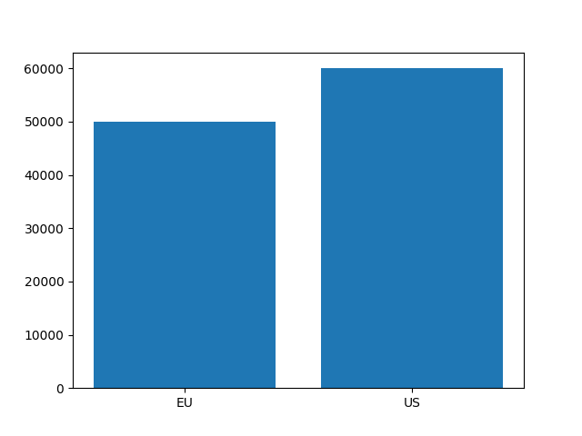 |  |

依頼文: `Total revenue by region`。ファイル: `sales.csv`。

<details><summary>プログラム</summary>

不合格:

```python
import matplotlib.pyplot as plt
plt.bar(["EU", "US"], [50000, 60000])
```

合格:

```python
import pandas as pd
import matplotlib.pyplot as plt
totals = pd.read_csv("/mnt/uploads/sales.csv").groupby("region")["revenue"].sum()
plt.bar(totals.index, totals.values)
plt.ylabel("revenue")
```

</details>

<a id="label_not_in_request"></a>

### `label_not_in_request`: 入力したすべてのカテゴリのラベルが依頼文にある

依頼文には数値しかなく、プログラムが apples、pears、plums というラベルを作っています。2 つのグラフは同じに見えますが、違いは依頼文にあります。

| 不合格 | 合格 |
|---|---|
| 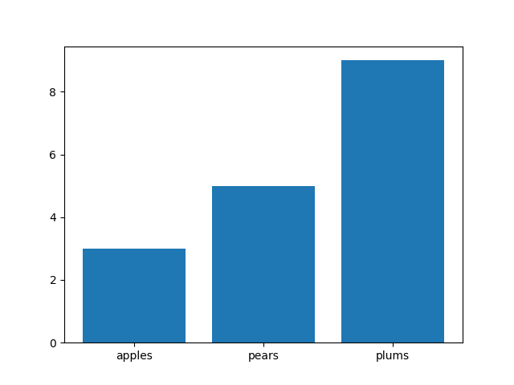 |  |

不合格のグラフの依頼文: `Plot 3, 5, 9`。合格するグラフの依頼文: `Plot apples 3, pears 5, plums 9`。

<details><summary>プログラム</summary>

不合格:

```python
import matplotlib.pyplot as plt
plt.bar(["apples", "pears", "plums"], [3, 5, 9])
```

合格:

```python
import matplotlib.pyplot as plt
plt.bar(["apples", "pears", "plums"], [3, 5, 9])
```

</details>

<a id="check-columns"></a>

## チェック 8: 描いた列が依頼と一致

<a id="column_not_requested"></a>

### `column_not_requested`: 依頼文にある列を別の列に置き換えない

依頼文は売上 (revenue) を求めていますが、グラフは依頼文にない列 orders を描いています。

| 不合格 | 合格 |
|---|---|
| 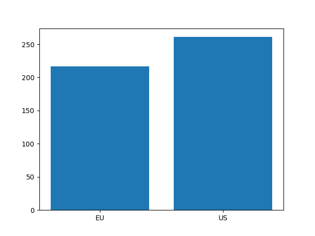 |  |

不合格のグラフの依頼文: `Chart revenue by region` (ファイル `sales.csv`)。合格するグラフの依頼文: `Total revenue by region` (ファイル `sales.csv`)。

<details><summary>プログラム</summary>

不合格:

```python
import pandas as pd
import matplotlib.pyplot as plt
totals = pd.read_csv("/mnt/uploads/sales.csv").groupby("region")["orders"].sum()
plt.bar(totals.index, totals.values)
```

合格:

```python
import pandas as pd
import matplotlib.pyplot as plt
totals = pd.read_csv("/mnt/uploads/sales.csv").groupby("region")["revenue"].sum()
plt.bar(totals.index, totals.values)
plt.ylabel("revenue")
```

</details>

<a id="column_not_named"></a>

### `column_not_named`: 本番環境: 依頼文が列を挙げるか除外する場合、描いた列をすべて挙げる

本番環境の規則です。依頼文は revenue を挙げていますが、グラフが描く month は挙げていません。2 つのグラフは同じです。month も挙げた依頼文が合格します。

| 不合格 | 合格 |
|---|---|
| 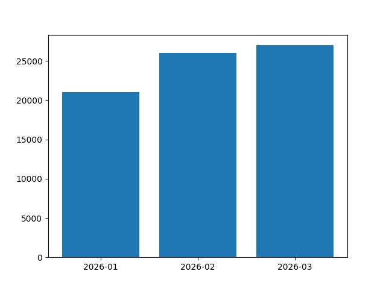 |  |

不合格のグラフの依頼文: `Total revenue` (ファイル `sales.csv`)。合格するグラフの依頼文: `Total revenue by month` (ファイル `sales.csv`)。

<details><summary>プログラム</summary>

不合格:

```python
import pandas as pd
import matplotlib.pyplot as plt
totals = pd.read_csv("/mnt/uploads/sales.csv").groupby("month")["revenue"].sum()
plt.bar(totals.index, totals.values)
```

合格:

```python
import pandas as pd
import matplotlib.pyplot as plt
totals = pd.read_csv("/mnt/uploads/sales.csv").groupby("month")["revenue"].sum()
plt.bar(totals.index, totals.values)
```

</details>

<a id="label_not_consistent"></a>

### `label_not_consistent`: タイトル、軸ラベル、凡例、カラーバーのラベル: 描いていない列なし。グループごとの合計または平均には、ほかの集計なし

棒は売上を示していますが、タイトルはファイルの別の列 orders を挙げています。

| 不合格 | 合格 |
|---|---|
| 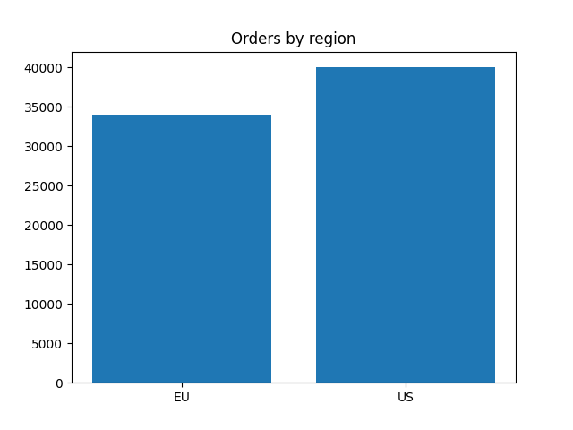 | 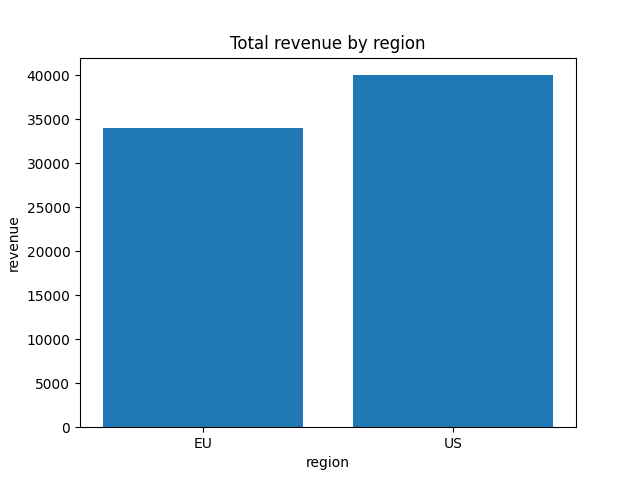 |

依頼文: `Total revenue by region`。ファイル: `sales.csv`。

<details><summary>プログラム</summary>

不合格:

```python
import pandas as pd
import matplotlib.pyplot as plt
totals = pd.read_csv("/mnt/uploads/sales.csv").groupby("region")["revenue"].sum()
plt.bar(totals.index, totals.values)
plt.title("Orders by region")
```

合格:

```python
import pandas as pd
import matplotlib.pyplot as plt
totals = pd.read_csv("/mnt/uploads/sales.csv").groupby("region")["revenue"].sum()
plt.bar(totals.index, totals.values)
plt.title("Total revenue by region")
plt.xlabel("region")
plt.ylabel("revenue")
```

</details>
